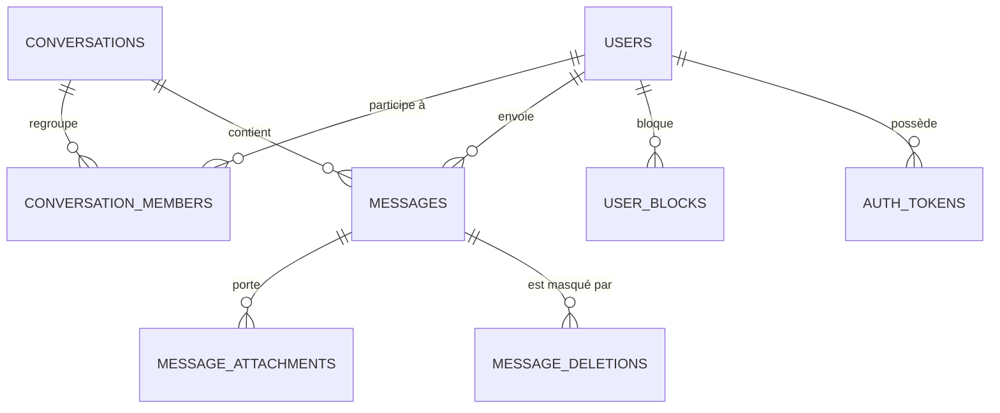

# Kadea Chat

**Kadea Chat** est une application de messagerie web réalisée pour **Kadea Academy** par l'équipe **NovaTech**.
On y échange en privé ou en groupe, les messages arrivent instantanément, sans recharger la page, et les
conversations sont retrouvées à chaque connexion.

🔗 **Site hébergé : https://VOTRE-SITE.onrender.com** _(à remplacer par l'adresse publique)_

## Sommaire

- [Technologies](#technologies)
- [Fonctionnalités](#fonctionnalités)
- [Installation en local](#installation-en-local)
- [Comptes de démonstration](#comptes-de-démonstration)
- [Variables d'environnement](#variables-denvironnement)
- [Organisation du code](#organisation-du-code)
- [Base de données](#base-de-données)
- [Sécurité](#sécurité)
- [Déploiement](#déploiement)

## Technologies

| Besoin                | Outil                                                         |
| --------------------- | ------------------------------------------------------------- |
| Framework             | AdonisJS 7 (architecture MVC)                                 |
| Vues                  | Edge (layouts et composants) + Tailwind CSS 4                 |
| Interactions          | Alpine.js                                                     |
| Base de données       | PostgreSQL (Lucid ORM)                                        |
| Temps réel            | Transmit (SSE, Server-Sent Events)                            |
| Validation            | VineJS                                                        |
| E-mails               | AdonisJS Mail + Brevo (SMTP)                                  |
| Fichiers              | AdonisJS Drive : disque local en développement, Supabase Storage (S3) en production |
| Hébergement           | Render                                                        |

## Fonctionnalités

### Comptes
- Inscription avec nom, e-mail et mot de passe.
- E-mail de confirmation avec lien ; **connexion impossible tant que l'adresse n'est pas confirmée** (avec renvoi du lien).
- Connexion, déconnexion, « se souvenir de moi ».
- Mot de passe oublié : e-mail de réinitialisation avec lien à usage unique.
- Profil : modification du nom, de la photo et du mot de passe.
- Recherche d'un utilisateur pour démarrer une conversation.

### Conversations privées
- Démarrer une discussion avec un autre utilisateur (une seule discussion par paire).
- Liste triée par activité, avec dernier message, date et badge de messages non lus.
- Historique conservé après rechargement ou reconnexion.
- Accès réservé aux membres : une conversation étrangère répond « page introuvable ».
- Supprimer une discussion de sa liste.

### Messages
- Envoi de messages texte et d'emojis, auteur et heure sur chaque message.
- Réception **en temps réel** dans les deux sens, sans actualisation.
- Modification (pendant un délai limité) et suppression : « pour moi » ou « pour tous » (une indication « Ce message a été supprimé » reste à sa place).
- Indicateur de saisie (« en train d'écrire… ») et reconnexion automatique avec rattrapage des messages manqués.

### Groupes
- Création d'un groupe avec un nom et plusieurs membres, photo de groupe.
- Seuls les membres lisent et écrivent dans le groupe.
- L'administrateur ajoute ou retire des membres ; la liste des membres est affichée.

### Fonctionnalités avancées
- **Statut des messages** : ✓ envoyé, ✓✓ reçu, ✓✓ bleus lu.
- **Messages non lus** : badge sur les conversations, onglets « Directes » et « Groupes » qui ne montrent que les discussions non lues.
- **Présence et saisie** : « En ligne » / « Hors ligne » et « en train d'écrire ».
- **Partage de fichiers** : images, vidéos, PDF, TXT et ZIP (5 fichiers et 20 Mo maximum, type et taille vérifiés).
- **Recherche de messages** : dans une conversation, et dans toutes ses conversations depuis la barre de la liste ; un résultat ouvre la conversation au message trouvé.
- **Blocage d'un utilisateur** : il ne peut plus écrire (ses messages ne sont jamais remis, sans qu'il en soit prévenu) ; déblocage depuis le profil.

### Interface
- Identité visuelle propre à Kadea Chat, utilisable sur ordinateur et sur téléphone (liste à côté de la discussion sur ordinateur, navigation adaptée sur mobile).
- États de chargement, d'erreur et de liste vide ; thème clair ou sombre.

## Installation en local

**Prérequis** : Node.js 24 ou plus, npm, PostgreSQL.

```bash
# 1. Récupérer le projet
git clone <URL_DU_DEPOT>
cd kadea_chat_adonis

# 2. Installer les dépendances
npm install

# 3. Configurer l'environnement
cp .env.example .env
node ace generate:key        # remplit APP_KEY dans .env
# puis renseigner DB_*, MAIL_* et SMTP_* dans .env (voir plus bas)

# 4. Créer la base PostgreSQL (nom = DB_DATABASE)
createdb kadea_chat

# 5. Créer les tables
node ace migration:run

# 6. Ajouter les données de démonstration (facultatif)
node ace db:seed --files database/seeders/demo_seeder.ts

# 7. Lancer l'application
npm run dev
```

L'application est disponible sur <http://localhost:3333>.

Autres commandes : `npm run lint`, `npm run typecheck`, `npm run build`.

## Comptes de démonstration

Après `db:seed`, cinq comptes déjà confirmés sont disponibles. **Mot de passe commun : `Kadea@2026`**

| Nom             | E-mail           | À montrer                                                       |
| --------------- | ---------------- | --------------------------------------------------------------- |
| Alice Mbuyi     | alice@kadea.cd   | Administratrice du groupe « Équipe Web », a des messages non lus |
| Bob Kabongo     | bob@kadea.cd     | Discussion lue avec Alice, membre du groupe                     |
| Chloé Ilunga    | chloe@kadea.cd   | Membre du groupe                                                |
| David Tshibanda | david@kadea.cd   | Messages envoyés à Alice, restés à un seul trait                |
| Esther Kalala   | esther@kadea.cd  | Aucune discussion : sert à vérifier l'accès refusé aux conversations des autres |

Le seeder peut être relancé sans créer de doublons.

## Variables d'environnement

Copier `.env.example` vers `.env` et renseigner les valeurs. **Ne jamais publier le fichier `.env`.**

| Variable                    | Rôle                                                              |
| --------------------------- | ----------------------------------------------------------------- |
| `TZ`, `PORT`, `HOST`        | Fuseau horaire, port et adresse d'écoute                          |
| `NODE_ENV`                  | `development` ou `production`                                     |
| `LOG_LEVEL`                 | Niveau des journaux                                               |
| `APP_KEY`                   | Clé secrète de l'application (`node ace generate:key`)            |
| `APP_URL`                   | Adresse publique du site (utilisée dans les liens des e-mails)    |
| `SESSION_DRIVER`            | Stockage des sessions (`cookie`)                                  |
| `DB_HOST`, `DB_PORT`        | Serveur PostgreSQL                                                |
| `DB_USER`, `DB_PASSWORD`    | Identifiants PostgreSQL                                           |
| `DB_DATABASE`               | Nom de la base                                                    |
| `MAIL_MAILER`               | `smtp`                                                            |
| `MAIL_FROM_NAME`            | Nom de l'expéditeur des e-mails                                   |
| `MAIL_FROM_ADDRESS`         | Adresse expéditrice (vérifiée chez Brevo)                         |
| `SMTP_HOST`, `SMTP_PORT`    | Serveur SMTP Brevo                                                |
| `SMTP_USERNAME`, `SMTP_PASSWORD` | Identifiants SMTP Brevo                                      |
| `DRIVE_DISK`                | `fs` (disque local) ou `s3` (production)                          |
| `S3_ACCESS_KEY_ID`, `S3_SECRET_ACCESS_KEY` | Clés d'accès au stockage Supabase                  |
| `S3_REGION`, `S3_BUCKET`    | Région et nom du bucket                                           |
| `S3_ENDPOINT`               | Adresse S3 du projet Supabase                                     |
| `S3_PUBLIC_URL`             | Adresse publique des fichiers (doit se terminer par `/`)          |
| `LIMITER_STORE`             | Stockage du limiteur de requêtes (`database`)                     |

## Organisation du code

Le projet suit le modèle **MVC** : les contrôleurs restent fins, la logique métier est dans des services.

```
app/
├── controllers/   Reçoivent la requête, appellent un service, renvoient une vue ou du JSON
├── models/        Modèles Lucid (User, Conversation, Message…)
├── services/      Règles métier : conversations, messages, blocage, présence, temps réel, e-mails
├── validators/    Validation des données saisies (VineJS)
└── middleware/    Authentification, accès invités
database/
├── migrations/    Structure de la base
└── seeders/       Données de démonstration
resources/
├── views/         Edge : layouts, composants, pages, partials
├── js/            Alpine.js et client temps réel
└── css/           Tailwind et thème
start/             Routes, limiteur, noyau HTTP
```

## Base de données

Schéma complet et description des tables : **[docs/schema_bdd.md](docs/schema_bdd.md)**.

Vue d'ensemble :



## Sécurité

- Mots de passe **hachés** (jamais stockés en clair, jamais renvoyés par l'application).
- Données validées côté serveur avec VineJS.
- Protection CSRF sur les formulaires, en-têtes de sécurité (Shield).
- Limitation du nombre de requêtes sur l'inscription, la connexion et l'envoi de messages.
- Jetons de confirmation et de réinitialisation à usage unique, avec expiration ; seul leur hachage est conservé.
- Droits vérifiés à chaque accès : conversations, groupes, messages, canaux temps réel. Un non-membre reçoit « introuvable ».
- Fichiers contrôlés (type et taille) avant envoi.

## Déploiement

Le site est hébergé sur **Render**, avec la base PostgreSQL de Render, **Brevo** pour les e-mails et **Supabase Storage** pour les fichiers.

1. Créer le service web et la base PostgreSQL sur Render.
2. Renseigner les variables d'environnement ci-dessus (avec `NODE_ENV=production`, `DRIVE_DISK=s3`, `APP_URL` = adresse du site).
3. Commandes (à adapter à la configuration du service) :
   - Build : `npm ci && npm run build`
   - Démarrage : `node ace migration:run --force && node build/bin/server.js`
4. Pour les données de démonstration : `node ace db:seed --files database/seeders/demo_seeder.ts`.

---

Projet réalisé par l'équipe NovaTech pour Kadea Academy.
