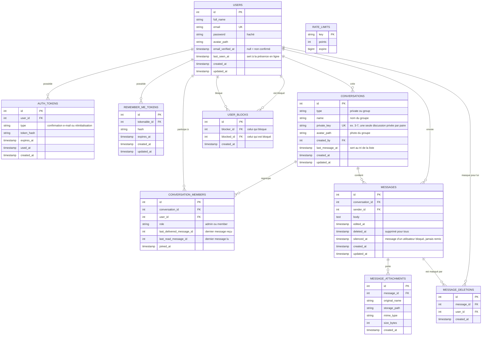

# Schéma de la base de données

Kadea Chat utilise **PostgreSQL**. Le schéma est géré par les migrations AdonisJS (`database/migrations`) ;
le fichier `database/schema.ts` est généré automatiquement à partir d'elles.

## Diagramme

## Rôle des tables

| Table                  | Rôle                                                                                                                                           |
| ---------------------- | ---------------------------------------------------------------------------------------------------------------------------------------------- |
| `users`                | Les comptes. Le mot de passe est haché ; `email_verified_at` reste vide tant que l'adresse n'est pas confirmée (connexion refusée).            |
| `auth_tokens`          | Jetons à usage unique pour la confirmation de l'e-mail et la réinitialisation du mot de passe. Seul le hachage du jeton est conservé.          |
| `remember_me_tokens`   | Jetons de la case « se souvenir de moi ».                                                                                                      |
| `conversations`        | Une ligne par discussion, privée ou groupe. `private_key` (unique) empêche deux discussions privées entre les mêmes personnes.                 |
| `conversation_members` | Les membres d'une conversation, avec leur rôle (`admin` / `member`) et deux repères (dernier message reçu, dernier message lu) pour les traits. |
| `messages`             | Les messages. La suppression « pour tous » est logique (`deleted_at`) : le texte est vidé et une indication apparaît à sa place.               |
| `message_attachments`  | Les fichiers joints (images, vidéos, PDF, TXT, ZIP) ; le fichier lui-même est dans le stockage S3.                                             |
| `message_deletions`    | « Supprimer pour moi » : le message est masqué pour un seul utilisateur. Sert aussi à cacher les messages d'un utilisateur bloqué.             |
| `user_blocks`          | Les blocages : `blocker_id` a bloqué `blocked_id`.                                                                                             |
| `rate_limits`          | Compteurs du limiteur de requêtes (protection contre les abus).                                                                                |

## Règles d'accès

- Une conversation n'est accessible qu'à ses membres (`conversation_members`). Pour tout autre utilisateur, la réponse est « page introuvable », comme si la conversation n'existait pas.
- Chaque lecture de messages ignore les messages masqués par l'utilisateur (`message_deletions`).
